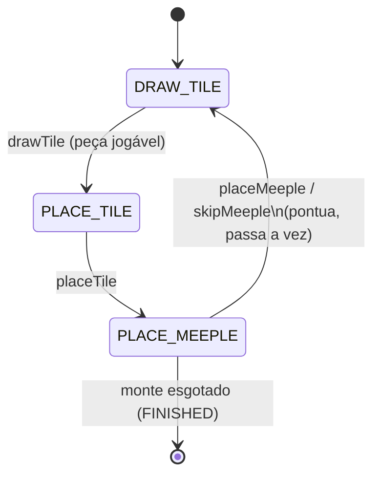

# Backend — Documentação

Núcleo do jogo inspirado em Carcassonne (Java 17, Spring Boot 3.3). Toda a lógica de regras fica no domínio, independente de interface (RNF06).

> [!NOTE]
> **API REST implementada em `/api/game`.** O backend expõe os endpoints HTTP documentados abaixo com suporte a CORS e tratamento de exceções.

## Executar

```powershell
cd backend
mvn test            # compila e roda os testes
mvn spring-boot:run # sobe a aplicação
```

Com JDK 25 é preciso: `-Dlombok.version=1.18.46 -Dmaven.compiler.proc=full` (o Lombok do Spring Boot 3.3.5 não funciona no JDK 25 e a JDK 23+ desliga processadores de anotação por padrão).

## Arquitetura

```
com.carcassonne
├── application
│   ├── port/in      GameInputPort, PlayerSetup   (porta de entrada hexagonal)
│   └── service      GameEngine                   (controller; orquestra o turno)
└── domain
    ├── board        Board, PlacedTile, Position, Placement, FeatureRef, FeatureRegion
    ├── game         Game (aggregate root), Turn + TurnState (State pattern), GameStatus
    ├── player       Player, PlayerColor, MeeplePlacement
    ├── rules        TilePlacementRules, MeeplePlacementRules, ScoringRules,
    │                FeatureConnectivity, *ScoringStrategy, ScoreAward
    ├── tile         Tile, TileFeature, EdgeContact, Direction, EdgeLane, Rotation,
    │                FeatureType, TileDeck, StandardTiles
    └── exception    GameActionException e subclasses
```

- `GameEngine` é o único ponto de entrada. Ele consulta as regras (sem estado) e chama os comandos do `Game`.
- `Game` protege as transições; `Turn` controla a fase com o padrão State.
- As regras recebem `Board`, `Tile` etc. e não dependem de `Game`.

## Porta de entrada — `GameInputPort`

| Método | Fase exigida | Retorno / efeito |
|---|---|---|
| `startGame(List<PlayerSetup>)` | — | Cria a partida (2–5 jogadores, cores distintas, 7 meeples cada). Peça inicial em (0,0). |
| `drawTile()` | DRAW_TILE | `Optional<Tile>`. Descarta automaticamente peças sem colocação legal. Vazio ⇒ monte esgotado e partida `FINISHED`. |
| `getLegalPlacements()` | PLACE_TILE | `List<Placement>` (posição + rotação) |
| `placeTile(Placement)` | PLACE_TILE | Posiciona a peça. `InvalidPlacementException` se ilegal. |
| `getLegalMeepleFeatures()` | PLACE_MEEPLE | `List<FeatureRef>`; vazia se o jogador não tem meeples |
| `placeMeeple(FeatureRef)` | PLACE_MEEPLE | Coloca o meeple e **resolve o turno**. `InvalidMeeplePlacementException` se ilegal. |
| `skipMeeple()` | PLACE_MEEPLE | Pula o meeple e **resolve o turno** |

Estado para exibição: `GameEngine.getGame()` devolve o `Game`, com `getBoard()`, `getPlayers()`, `currentPlayer()`, `getStatus()`, `getMeeples()`, `availableMeeples(player)`, `getDeck().remaining()`, `currentDrawnTile()` e `currentPlacedTile()`.

### Fluxo de um turno



Sequência típica do cliente: `drawTile → getLegalPlacements → placeTile → getLegalMeepleFeatures → placeMeeple | skipMeeple`. Ao final de `placeMeeple`/`skipMeeple` o engine pontua estruturas concluídas, devolve meeples, avança o jogador (ou encerra a partida).

### Erros

| Exceção | Quando |
|---|---|
| `InvalidTurnPhaseException` | Ação fora da fase, decisão de meeple repetida ou partida já encerrada |
| `InvalidPlacementException` | Peça em posição/rotação ilegal |
| `InvalidMeeplePlacementException` | Meeple em região ocupada, fora da peça do turno ou sem meeples |
| `IllegalStateException` | Nenhuma partida iniciada |
| `IllegalArgumentException` | Dados inválidos (jogadores, cores) |

Todas as `GameActionException` são erros de regra: o frontend deve mapeá-las para HTTP 4xx (ex.: 409/422), mantendo o estado inalterado.

## Modelo de dados (para montar DTOs)

| Tipo | Campos |
|---|---|
| `Position` | `x`, `y` — **NORTH = y+1**, EAST = x+1 |
| `Rotation` | `DEG_0`, `DEG_90`, `DEG_180`, `DEG_270` (sentido **horário**) |
| `Placement` | `position`, `rotation` |
| `Tile` | `features: List<TileFeature>` |
| `TileFeature` | `id`, `type` (CITY/ROAD/MONASTERY/FIELD), `shieldCount`, `edgeContacts` |
| `EdgeContact` | `side` (NORTH/EAST/SOUTH/WEST), `lane` (LEFT/CENTER/RIGHT) — lados **sem rotação** (da peça original) |
| `PlacedTile` | `tile`, `position`, `rotation` |
| `FeatureRef` | `position`, `featureId` — identifica uma feature numa peça posicionada |
| `MeeplePlacement` | `player`, `feature` (`FeatureRef`) |
| `Player` | `name`, `color`, `score` |
| `PlayerColor` | RED, BLUE, GREEN, YELLOW, BLACK |

### Notas para renderizar o tabuleiro
- Rotacione a imagem da peça em `rotation` graus no sentido horário. Um lado local `s` aparece em `s.rotate(rotation)`.
- `Tile` não tem identificador/tipo de imagem. O frontend precisará de um `tileId`/`type` (ex.: letras A–X de `StandardTiles`) para escolher o sprite — **ainda não existe**.
- `Board.getTiles()` devolve todas as peças; o tabuleiro é esparso e cresce em qualquer direção (coordenadas negativas são válidas).
- Meeple: use `FeatureRef` para posicionar o marcador na peça (a posição visual dentro da peça é responsabilidade do frontend).

## Regras implementadas

| Regra | Onde |
|---|---|
| Posição livre, ≥ 1 vizinho ortogonal, bordas compatíveis (RN01–RN03) | `TilePlacementRules` |
| Compatibilidade de borda | Tipo da feature na lane CENTER (ou LEFT/RIGHT se ausente) |
| Meeple só na peça do turno, região sem meeple (RN05, RN06) | `Game.placeMeeple`, `MeeplePlacementRules` |
| Regiões conectadas por BFS e detecção de conclusão | `FeatureConnectivity` |
| Maioria e empate de meeples (RN09) | `ScoringRules` |
| Pontuação ao completar (RN07) e retorno de meeples (RN08) | `ScoringRules` + `Game.applyAwards` |

Pontuação ao completar: **estrada** = 1/peça · **cidade** = 2/peça + 2/escudo · **mosteiro** = 9.

## API REST — `/api/game`

| Método | Rota | Descrição |
|---|---|---|
| `POST` | `/api/game` | Inicia partida (`StartGameRequest`) |
| `GET` | `/api/game` | Retorna o estado completo (`GameStateDto`) |
| `POST` | `/api/game/draw` | Sorteia próxima peça jogável |
| `GET` | `/api/game/placements` | Lista posições e rotações legais |
| `POST` | `/api/game/tile` | Posiciona a peça (`PlacementRequest`) |
| `GET` | `/api/game/meeples` | Lista opções de meeple elegíveis |
| `POST` | `/api/game/meeple` | Aloca meeple na peça (`MeepleRequest`) |
| `POST` | `/api/game/skip` | Pula meeple e resolve o turno |

## Pendências e Próximos Passos

- [x] **Camada REST** (controller + DTOs), expondo os 7 métodos de `GameInputPort` e estado da partida.
- [x] **CORS** e tratamento global de exceções (`@RestControllerAdvice`) para `GameActionException`.
- [x] **Identificador de peça** (`tileId`) nas 72 peças padrão.
- [ ] **Estado compartilhado:** `GameEngine` é um singleton Spring com **uma única partida** (campo `game`). Para várias partidas simultâneas é preciso um repositório por id.
- [ ] **Fim de jogo completo:** `finishGame()` só marca `FINISHED`. Faltam `scoreEndGame`, `endGameAwards`, `winners` (RF31–RF34, RF47) e a pontuação de campos.
- [ ] Os dados de `StandardTiles` descrevem poucas lanes por borda; a conectividade de campos pode exigir ajustes.

## Testes

`backend/src/test/java/.../application/service/`:
- `GameInitializationTest` — criação da partida.
- `GameTurnFlowTest` — rotação/bordas, ordem das fases, colocação inválida e partida completa até esgotar o monte.
